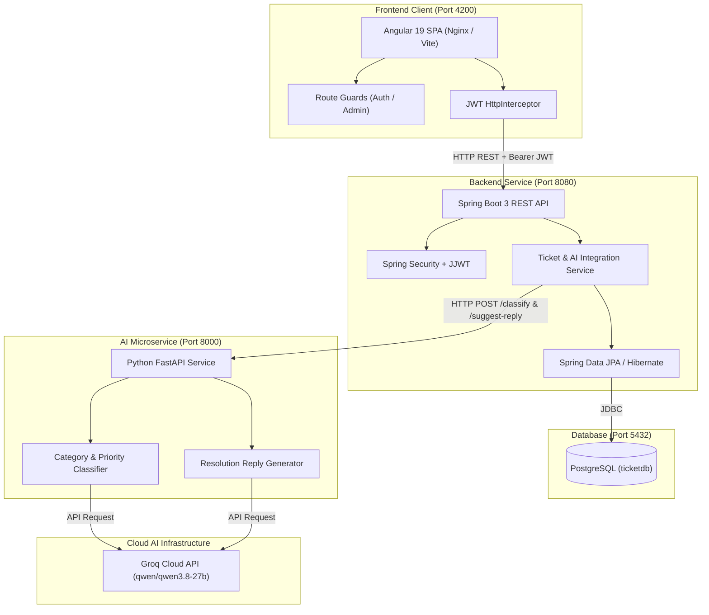

# 🎫 AI-Powered Support Ticket System
[](LICENSE)
[](https://spring.io/projects/spring-boot)
[](https://angular.dev/)
[](https://fastapi.tiangolo.com/)

An enterprise-grade, end-to-end full-stack support ticket management platform with automated AI issue classification, dynamic priority scoring, and smart resolution suggestions powered by Groq LLM.

---

## 🌟 Key Features

- **🔐 Robust JWT Authentication & Role-Based Access (RBAC)**
  - Stateless Spring Security with BCrypt password hashing.
  - Dedicated user roles: `USER` (customer/client) and `ADMIN` (support manager).
  - Unregistered user detection with proactive guidance to registration.
- **🤖 Autonomous AI Microservice (Groq Cloud LLM)**
  - Automatic category classification (`ACCOUNT`, `BILLING`, `TECHNICAL`, `GENERAL`).
  - Automated urgency & priority calculation (`LOW`, `MEDIUM`, `HIGH`).
  - Pre-generated, context-aware suggested reply for support agents with a 1-click clipboard copy tool.
  - Resilient fallbacks if LLM is unreachable.
- **💻 Modern Angular 19 Client**
  - Standalone component architecture with reactive signals.
  - User Dashboard with real-time statistics (Total, Open, In Progress, Resolved).
  - Ticket Creation wizard with live AI processing state.
  - Admin Triage Portal with inline status management (`OPEN` ➔ `IN_PROGRESS` ➔ `RESOLVED`).
  - Route guards (`authGuard`, `adminGuard`) and automatic JWT HTTP interceptor.
- **🐳 Full Containerization**
  - Multi-stage Dockerfiles for Backend (Temurin Java 21) and Frontend (Nginx Alpine).
  - One-command orchestration via `docker-compose.yml`.

---

## 🏗️ System Architecture



---

## 📂 Project Structure

```
Support Ticket System/
├── backend/                  # Java 21 / Spring Boot 3 REST API
│   ├── src/main/java/com/ticketsystem/backend/
│   │   ├── config/           # Security, CORS & RestTemplate configuration
│   │   ├── controller/       # Auth, Ticket, User controllers
│   │   ├── dto/              # Request / Response DTOs
│   │   ├── entity/           # User, Ticket, Role, Status, Category, Priority entities
│   │   ├── repository/       # Spring Data JPA repositories
│   │   ├── security/         # JwtUtil, JwtAuthFilter
│   │   └── service/          # AuthService, TicketService, AiServiceClient
│   ├── pom.xml               # Maven build configuration
│   └── Dockerfile            # Multi-stage JRE container
│
├── ai-service/               # Python 3.11 / FastAPI AI Microservice
│   ├── main.py               # /classify and /suggest-reply endpoints
│   ├── requirements.txt      # FastAPI, Uvicorn, Groq, pinned httpx
│   ├── .env                  # Groq API Key configuration
│   └── Dockerfile            # Python slim container
│
├── frontend/                 # Angular 19 Standalone Application
│   ├── src/app/
│   │   ├── components/       # Navbar, Login, Register, Home, Tickets, Admin
│   │   ├── guards/           # authGuard, adminGuard
│   │   ├── interceptors/     # authInterceptor (JWT header injection)
│   │   ├── models/           # TypeScript interfaces & types
│   │   └── services/         # AuthService, TicketService
│   ├── nginx.conf            # Production Nginx SPA configuration
│   ├── package.json          # Node dependencies
│   └── Dockerfile            # Multi-stage Nginx container
│
├── docker-compose.yml        # Orchestration for all 4 microservices
├── .env.example              # Sample environment configuration
└── README.md                 # Complete documentation
```

---

## 🚀 Quick Start Guide

### Option 1: Running with Docker Compose (Recommended)

1. Clone or navigate to the project directory:
   ```bash
   cd "D:\Final Year projects\Support Ticket System"
   ```
2. Copy `.env.example` to `.env` and add your Groq API key:
   ```bash
   cp .env.example .env
   # Edit .env and supply your GROQ_API_KEY=gsk_...
   ```
3. Run all containers:
   ```bash
   docker compose up --build
   ```
4. Access the applications:
   - **Frontend UI:** `http://localhost:4200`
   - **Backend API:** `http://localhost:8080/api/hello`
   - **AI Service Docs:** `http://localhost:8000/docs`

---

### Option 2: Running Locally (Development Mode)

#### Prerequisites
- **Java 21 JDK**
- **Python 3.10+**
- **Node.js 20+ & npm**
- **PostgreSQL 15+**

#### 1. PostgreSQL Database
1. Ensure PostgreSQL is running on port `5432`.
2. Create the database:
   ```sql
   CREATE DATABASE ticketdb;
   ```

#### 2. AI Microservice (FastAPI)
```bash
cd ai-service
# Create and activate virtual environment
python -m venv venv
.\venv\Scripts\activate   # Windows PowerShell: .\venv\Scripts\Activate.ps1

# Install requirements
pip install -r requirements.txt

# Run FastAPI server
uvicorn main:app --reload --port 8000
```
- Verified at: `http://localhost:8000/hello`

#### 3. Spring Boot Backend
```bash
cd backend
# Run Spring Boot via Maven wrapper
.\mvnw.cmd spring-boot:run
```
- Verified at: `http://localhost:8080/api/hello`

#### 4. Angular Frontend
```bash
cd frontend
# Install dependencies
npm install --legacy-peer-deps

# Start development server
npm start
```
- Verified at: `http://localhost:4200`

---

## 🔑 Demo User Accounts

| Role | Email | Password | Permissions |
|---|---|---|---|
| **Administrator** | `dasdebasrita796@gmail.com` | `123456` | Access Admin Portal (`/admin`), view all tickets, update statuses inline |
| **Regular User** | `alice@example.com` | `password123` | Create tickets, view personal tickets, receive AI suggestions |

> **Note:** These credentials are provided for local development, evaluation, and demonstration purposes.

---

## 📡 REST API Reference

### Authentication Endpoints (`/api/auth`)
| Method | Endpoint | Access | Description |
|---|---|---|---|
| `POST` | `/api/auth/register` | Public | Register new user account (returns JWT) |
| `POST` | `/api/auth/login` | Public | Authenticate user (returns JWT & role) |
| `GET` | `/api/me` | Authenticated | Validate token and retrieve user identity |

### Ticket Endpoints (`/api/tickets`)
| Method | Endpoint | Access | Description |
|---|---|---|---|
| `POST` | `/api/tickets` | `USER`, `ADMIN` | Submit ticket; triggers synchronous AI analysis |
| `GET` | `/api/tickets/my` | `USER`, `ADMIN` | Retrieve tickets created by current user |
| `GET` | `/api/tickets/{id}` | Owner or `ADMIN` | Retrieve single ticket details & AI suggestion |
| `GET` | `/api/tickets` | `ADMIN` only | Retrieve all platform tickets |
| `PATCH`| `/api/tickets/{id}/status`| `ADMIN` only | Update ticket status (`OPEN`, `IN_PROGRESS`, `RESOLVED`) |

### AI Endpoints (`http://localhost:8000`)
| Method | Endpoint | Description |
|---|---|---|
| `POST` | `/classify` | Classifies title & description into Category and Priority |
| `POST` | `/suggest-reply` | Crafts an empathetic, step-by-step resolution draft |

---

## 🛡️ Technical Challenges & Solutions

1. **PostgreSQL Reserved Word Conflict**:
   - *Problem:* PostgreSQL reserves `user` as a keyword.
   - *Fix:* Explicitly mapped `@Table(name = "users")` in `User.java`.
2. **Spring Security Error Forwarding (403 on 404/409)**:
   - *Problem:* Spring Boot dispatches uncaught exceptions to `/error`, which was originally blocked by Spring Security.
   - *Fix:* Added `/error` to `requestMatchers(...).permitAll()` in `SecurityConfig.java`.
3. **Groq Client vs HTTPX 0.28+ Incompatibility**:
   - *Problem:* `groq==0.11.0` passes deprecated `proxies=` argument which fails on `httpx >= 0.28.0`.
   - *Fix:* Pinned `httpx==0.27.2` in `requirements.txt`.
4. **Angular 19 Production Build Path**:
   - *Problem:* Angular 17+ outputs to `dist/frontend/browser` rather than `dist/frontend`.
   - *Fix:* Configured `frontend/Dockerfile` to copy specifically from `/app/dist/frontend/browser` to Nginx web root.
5. **CORS Preflight Filtering**:
   - *Problem:* Browser OPTIONS requests from `localhost:4200` to `localhost:8080` were blocked.
   - *Fix:* Configured `CorsConfigurationSource` in Spring Security allowing all REST methods and headers.

---

## 📄 License

This project is licensed under the **MIT License** - see the [LICENSE](LICENSE) file for details.

---

## 👩‍💻 Author

**Debasrita Das**  
- GitHub: [@debasrita15](https://github.com/debasrita15)
